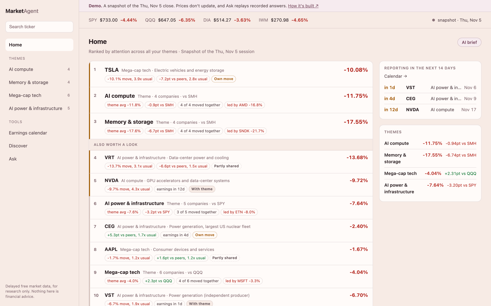
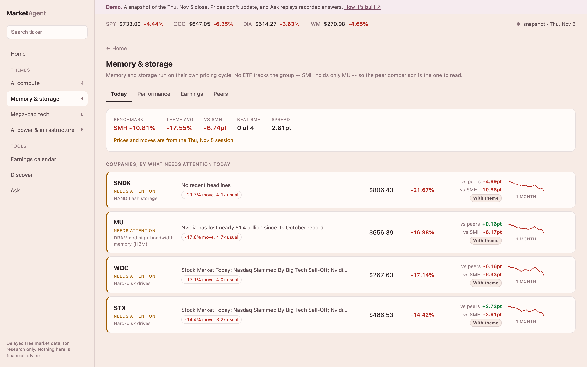
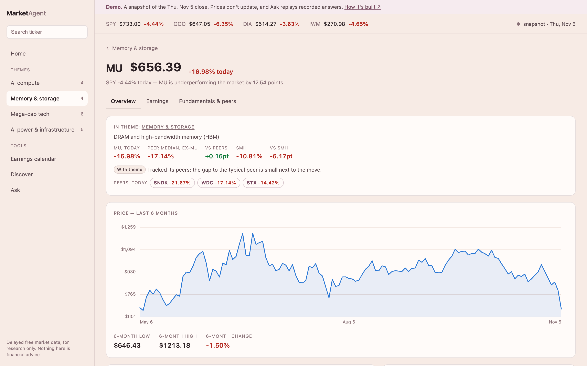
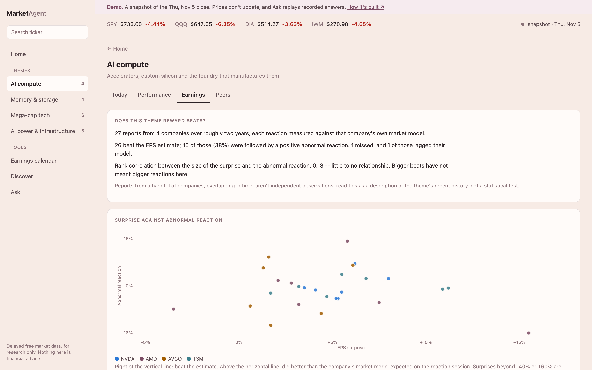
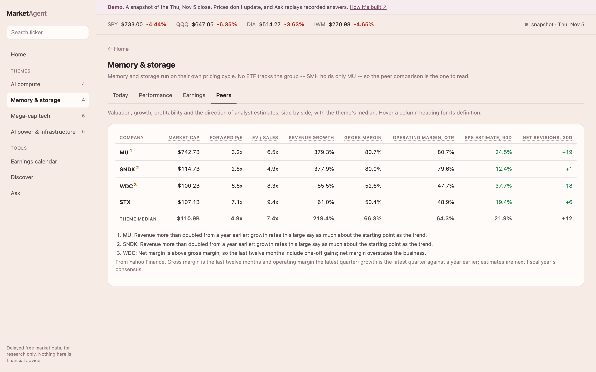
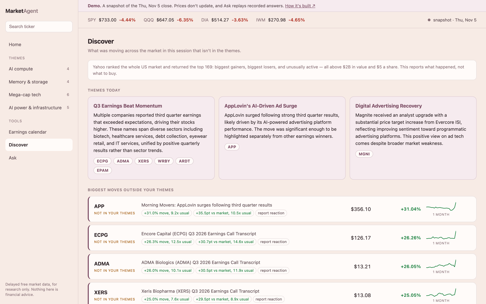
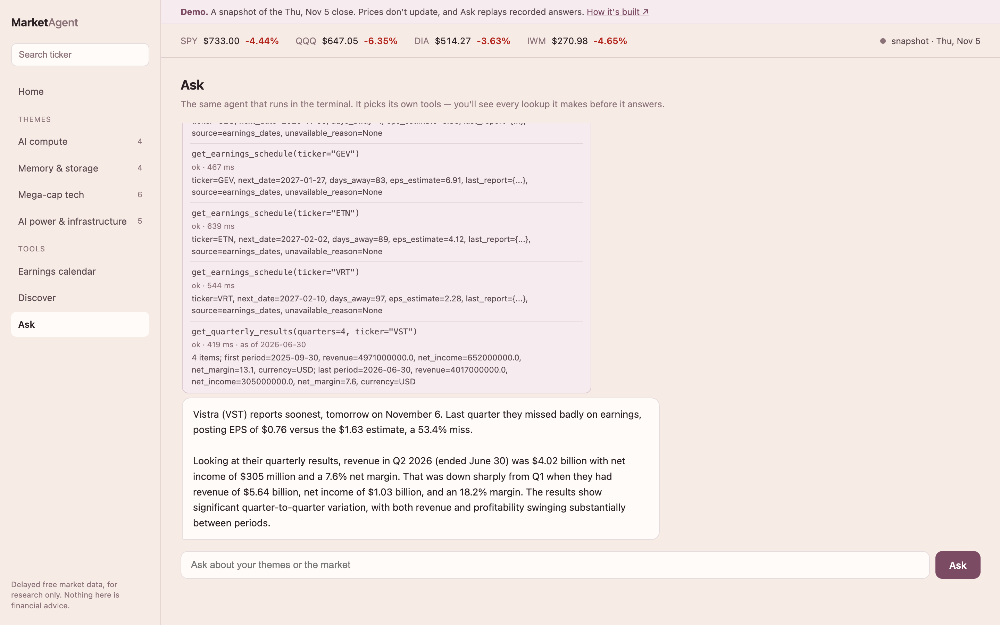

# Market Agent

A stock watchlist that tells you, theme by theme, which companies moved
with their group and which moved on their own, and a tool-using Claude
agent that answers questions from live market data instead of from memory.
Plain Python rules do the ranking; Claude only explains.

<!-- TODO: link to the hosted static demo once it's published -->

> Not financial advice. Data comes from free, delayed Yahoo Finance endpoints
> and can be incomplete or wrong. The prompts forbid buy/sell/hold opinions,
> price targets and predictions of direction.

## One session with it

You follow four themes: AI compute, memory & storage, mega-cap tech, and AI
power. You open the dashboard to answer three questions: what changed, why
it might matter, and what to check next. The screenshots are from the
static snapshot of the Monday 5 October 2026 close, and every page says
which session its prices are from.



**What changed.** Home has one card per theme. Each shows the theme's
equal-weighted move against its ETF, how many companies beat the ETF, and
the spread between them. AI compute was up 1.65% against SMH's 0.50%, and
each company is tagged *With theme*: the group moved together. Memory &
storage was up 2.46% on average, but every company is tagged *Own move*.
Above the cards, an AI brief tells each theme's story once and names the
companies that broke from their group. It ends with the coming reports,
here "TSM reports in 10 days".



**Why it might matter.** On the theme page, the *Today* tab orders the
companies by an attention score. Each row shows the chips that earned its
rank, such as "+6.3% move", "+6.8pt vs peers" or "earnings in 3d", so you
can see why a company sits where it does. WDC (+6.32%) and STX (+4.78%)
*need attention*. SNDK and MU fell slightly and are *worth a look*: each
was more than 5 points behind its peers. The page notes that SMH holds
only MU, so for this theme the peer comparison is the one to read.

"Peers" means the median move of the *other* companies in the theme. This
matters because cap-weighted ETFs are dominated by the names being
measured. The median is used because in a group of four, one extreme name
would decide an average.



**What to check.** MU's page puts its −0.49% beside its peers' median of
+4.78% (−5.27pt) and SMH (−0.99pt). Below that come a six-month chart, an
AI analysis (told to report the headlines beside the move, not to claim
they caused it), and the headlines themselves. The *Earnings* tab measures
the last eight reports with a market model: the move beyond what beta and
SPY predicted, and how unusual it was for this stock. You can also ask the
agent in the *Ask* panel, for example "which of my names reports soonest,
and how did it do last quarter?". It shows every tool call it made before
it answers.

**When data is missing.** If a news or calendar lookup fails, the page
says "Headlines couldn't be loaded" instead of "No recent headlines". A
company that would otherwise rank *quiet* is marked *Data incomplete*,
because a broken source shouldn't read as a calm company. The AI analysis
is told which lookup failed and says so.

## Design choices

- **Rules rank; the model explains.** The dashboard knows what every row
  needs, so it fetches in parallel and ranks with Python. A model makes a
  slow, costly and inconsistent sort function, but a good explainer. The
  agent handles questions no one can anticipate, so there the model
  chooses the tools.
  [DESIGN](docs/DESIGN.md#rank-with-rules-explain-with-the-model)
- **A move is measured against its peers, not just an ETF.** The rule
  for calling a move the theme's or the company's own was rewritten twice
  after live data broke it.
  [DESIGN](docs/DESIGN.md#themes-measuring-a-move-against-its-peers)
- **It refuses what it can't know.** It gives no buy/sell/hold opinion, no
  price target and no forecast. Asked whether a stock will rise after
  earnings, the agent says the direction isn't knowable and shows what
  happened after past reports instead.
  [DESIGN](docs/DESIGN.md#will-it-go-up-after-earnings)
- **Rules that a prompt can't hold are enforced in code.** If the model
  compares moves as multiples ("twice its peers"), or makes a claim that a
  failed lookup can't support, `guards.py` catches it and the app asks for
  a rewrite. [analysis-guard](evals/tuning/analysis-guard-2026-10.md)
- **The AI text is evaluated with criteria written before the runs.** Each
  tuning round commits its train/test split and pass criteria before any
  run, keeps the test set unread until the end, and records missed
  criteria as missed. Regex checks what is fixed; an LLM judge grades the
  rest and fails closed; the checks are fed bad output to prove they can
  fail. [evals/tuning/](evals/tuning/),
  [DESIGN](docs/DESIGN.md#evals--testing-the-part-that-isnt-deterministic)

The reasoning and the mistakes behind these choices are in
[docs/DESIGN.md](docs/DESIGN.md). [docs/LOG.md](docs/LOG.md), in Chinese,
logs what was done and who decided what.

## How well does it work?

All figures come from the records linked. The model is claude-sonnet-4-5,
and the same model acts as judge, so the two can share a blind spot.

- **The brief prompt** ([brief-prompt-2026-10.md](evals/tuning/brief-prompt-2026-10.md)):
  on a held-out test set, the judge pass rate rose from **14/40 (35%) to
  31/40 (78%)**. The noise floor at this size is about 25 points. Fixing
  the brief's input and the harness afterwards took it to 38/40, but by
  then the test set had been read, so 35% → 78% is the honest headline.
- **The stock-analysis prompt** ([analysis-prompt-2026-10.md](evals/tuning/analysis-prompt-2026-10.md)):
  on a held-out test set, it rose from **18/24 (75%) to 45/48 (94%)**.
  The gain of 19 points has a 95% interval of about ±19, so treat it as
  directional.
- **The multiples guard** ([analysis-guard-2026-10.md](evals/tuning/analysis-guard-2026-10.md)):
  multiples in the shown text fell from **5 in 112 runs to 0 in 88**
  (p = 0.07). The model wrote a multiple only once in those 88 runs, and
  the guard caught it. That shows the mechanism works, not a measured
  rate. It costs about one extra model call per hundred pages.
- **The attention score** ([validation/attention-2026-10.md](validation/attention-2026-10.md),
  a backtest over 19 companies and 439 sessions in 2025–26): it tracks
  the market's own attention. Its correlation with same-day abnormal
  volume is **IC +0.29 [+0.26, +0.33]**, and its top-ranked company had
  its theme's most unusual volume on **42%** of theme-days, against 22% by
  chance. It **barely beats simple baselines**, though:
  - The day's move alone scores +0.27. The peer and earnings parts add
    only **+0.026 [+0.007, +0.046]**.
  - A volatility-scaled move on its own does as well as the whole score:
    the difference is +0.006 [−0.025, +0.037].
  - It doesn't predict the next session: **+0.00 [−0.02, +0.03]**.
  - It favours volatile stocks. TSLA tops its theme on 41% of days,
    against 17% for an even split.

  The changes the backtest suggests have not been made.
- **The first batch of the outside review** ([batch1-2026-11.md](evals/tuning/batch1-2026-11.md)):
  - When a lookup fails, the analysis now says so. "No news" for a failed
    news lookup went from 24 of 24 runs to **0 of 24**, and "no report
    scheduled" for a failed calendar went from 23 of 24 to **0 of 24**.
  - The brief's calendar is fixed: **no calendar claim failed in 96 runs**
    after the fix.
  - The brief still claims that a name whose news failed had no news in
    **about 1 brief in 10** (5 of 48, down from 12 of 24). That missed
    its criterion of at most 2 of 48. The author merged the batch anyway
    and deferred this item, along with a false match in the
    forbidden-phrasing check ("buy these chips"), to the next batch.

## Setup

Requires Python 3.9+ and an [Anthropic API key](https://console.anthropic.com).

```bash
git clone <repo-url> market-agent && cd market-agent
python3 -m venv .venv && source .venv/bin/activate
pip install -r requirements.txt
cp .env.example .env          # then put your key in .env
python3 web/app.py            # then open http://127.0.0.1:5050
```

On macOS you can instead double-click `start.command`, which starts the
server and opens the browser. You can also use the agent from the
terminal:

```bash
python3 agent.py                                  # interactive
python3 agent.py AAPL TSLA                        # quick update on each ticker
python3 agent.py "what moved most in the market today?"
```

| Variable | Required | Purpose |
|---|---|---|
| `ANTHROPIC_API_KEY` | yes | Claude API access |
| `MARKET_AGENT_MODEL` | no | Model for every Claude call, including the eval judge. Defaults to `claude-sonnet-4-5`. |

Themes are saved to `web/themes.json`, which is per-machine and not
committed. On first run it's created from the default themes. Anything in
an older `web/watchlist.json` that the themes don't cover is kept in an
"Other" theme.

### Tests and evals

```bash
python3 run_tests.py                     # offline: no network, no key; CI runs these
python3 evals/run_evals.py               # brief, stock analysis, themes: real model, costs money
python3 evals/run_agent_evals.py         # agent tool choices, real model on stubbed data
python3 evals/run_evals.py --runs 5 --save   # pass rates, recorded to evals/results/
python3 evals/run_evals.py --dry-run     # exercise the harness, no API calls
python3 evals/rejudge.py --scenario <name> <saved.json>   # re-judge saved outputs
```

`--judge-stability N` tells a noisy judge apart from a noisy output.
`python3 test_tools.py AAPL` is a live smoke test of the data tools, and
`python3 tools/check_sources.py` reports which data sources are reachable
from your network.

### Static demo

A public live app would pay for every visitor's AI calls and get
rate-limited by Yahoo from a cloud host. Instead, `demo/build.py` walks
the live app once and saves every page's data as JSON beside a copy of the
frontend. The demo is read-only, says which session it's from, and replays
the Ask panel's suggested questions as recorded. Build it after the
close; during trading hours the prices are intraday.

```bash
python3 demo/build.py                       # writes demo/site/ (gitignored)
python3 -m http.server -d demo/site 8000    # look at it locally
python3 demo/capture.py --video             # retake the screenshots (needs Playwright)
```

The snapshot contains Yahoo Finance data via yfinance, whose use is
governed by Yahoo's terms.

## Features

- **Home**: one card per theme: its move against its ETF, breadth,
  dispersion, earnings this week, and the companies most in need of
  attention, under an AI brief.
- **Theme page**:
  - *Today*: each company against the ETF and its peers, ranked by
    attention, with notes and controls to edit the theme.
  - *Performance*: 1M to 1Y returns against the ETF and the peers.
  - *Earnings*: abnormal reactions from an event-study market model, the
    run-up before each report, and the rank correlation between surprise
    and reaction, with its sample size.
  - *Peers*: valuation, growth, margins and estimate revisions, with the
    theme median and flags where a figure would mislead.
- **Stock page**: *Overview* (place in its theme, chart, AI analysis,
  headlines), *Earnings* (next report, reaction to each of the last
  eight), *Fundamentals & peers*.
- **Earnings calendar**: the next two weeks by theme, then three months.
- **Discover**: market-wide gainers, losers and unusually active names
  (above $2B market cap and $5 a share), grouped into themes, each
  addable to yours.
- **Ask**: the agent, with every tool call shown. It has twelve tools,
  covering prices, history, news, earnings, quarterly results, key stats,
  the scanner, market news, events, the watchlist and a calculator, and
  is capped at 12 steps.
- Themes and their companies can be created, edited and moved from the
  page.

<table>
<tr>
<td width="50%"></td>
<td width="50%"></td>
</tr>
<tr>
<td></td>
<td></td>
</tr>
</table>

## Project layout

```
agent.py              the agent: tool schemas, the loop, the CLI
config.py             shared settings (model, .env loading)
themes.py             theme storage: defaults, validation, upgrade from the old watchlist
guards.py             rules on AI text enforced in code (multiples, claims a failed lookup can't support)
tools/
  market_data.py      price, price history, company news, upcoming events
  market_scan.py      market-wide movers and market news
  fundamentals.py     earnings schedule and setup, quarterly results, key stats
  relative.py         peer medians, theme-vs-company attribution, breadth, dispersion
  performance.py      period returns, the event-study market model, rank correlation
  calc.py             safe arithmetic for the agent (parsed, never eval'd)
  check_sources.py    which data sources work from this network
  probe_*.py          scripts that inspect raw API payloads
web/
  app.py              Flask server: ranking, brief, analysis, Discover, earnings, chat
  static/             single-page frontend, vanilla JS, no build step
evals/                model evals, scenarios, and tests of the checks
evals/rejudge.py      judges saved outputs again with a scenario's current rubric
evals/results/        saved eval runs, cited by the tuning logs
evals/tuning/         plans and results of each tuning round
evals/borderline/     real outputs that sat on a rubric's edge, kept for re-judging
demo/build.py         builds the static demo snapshot
demo/capture.py       screenshots and a walkthrough video of the snapshot
validation/           backtests of the hand-set rules, with their reports
run_tests.py          runs every offline suite
docs/DESIGN.md        design decisions and lessons
docs/LOG.md           project log (Chinese): what was done, the results, and who decided what
docs/MarketAgent_Review_and_Improvement_Plan.md   the outside review (Chinese)
```

## Known limits

- The data is free and delayed, via yfinance. There's no intraday
  streaming, options flow or dark pool data. When a ticker's own Yahoo
  news feed is empty (as it was for every ticker in October 2026),
  headlines come from Yahoo's search endpoint. Those have no summaries,
  so the AI text works from headlines alone.
- The news part of the attention score counts the latest headlines
  whatever their age, so it barely varies. On 5 October every company
  had the maximum.
- The attention weights are hand-set. The attribution thresholds (40% /
  60% of the larger move, with a 1-point floor) haven't been validated.
- A theme that splits in two (disk makers up, flash and DRAM down, as on
  5 October) labels every company *Own move*. That's true, but it hides
  that each half moved together; there are no sub-groups yet.
- Theme averages are equal-weighted, so one extreme name still moves them.
- Market-model betas estimated during a strong sector rally run high.
  The earliest report in each history lacks enough prior data for a
  model and is shown raw. Some report times from Yahoo carry a
  placeholder hour, which puts the reaction on the wrong session.
- Yahoo's operating margin is quarterly, gross and net margins twelve
  months; the pages label it. Market hours ignore holidays. Discover falls
  back to a fixed large-cap list, and says so, if Yahoo's screener fails.
- Notes and alerts aren't built; real alerts need a background scheduler.

## License

[MIT](LICENSE)
