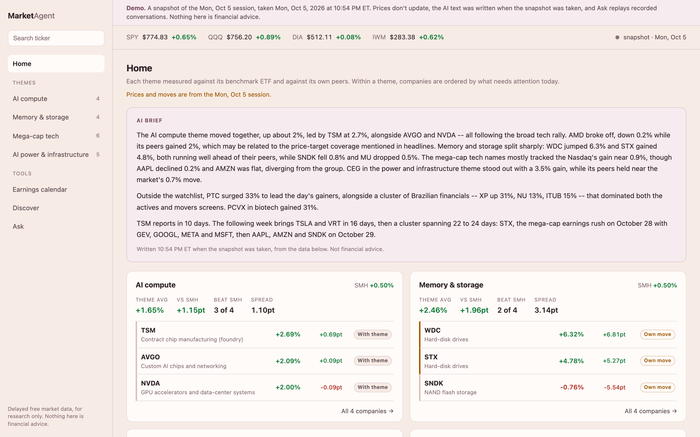
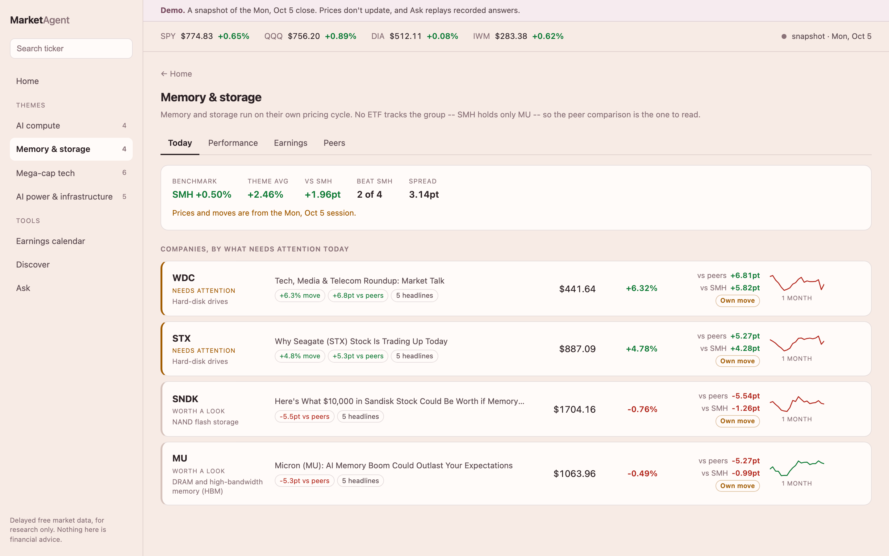
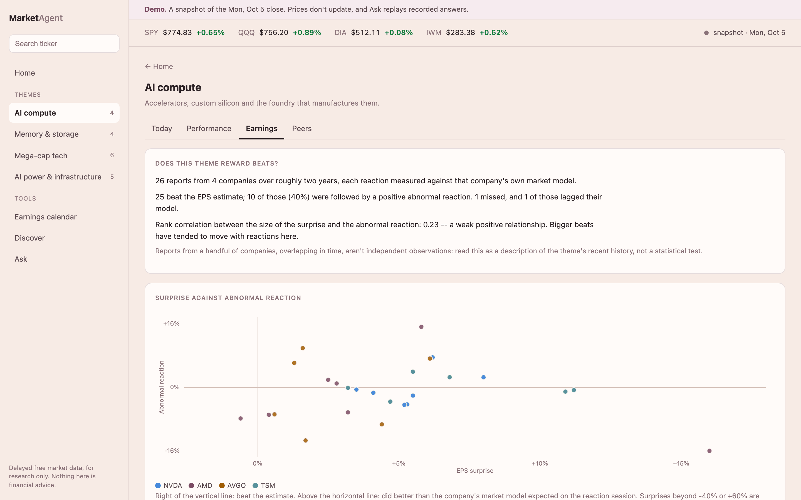
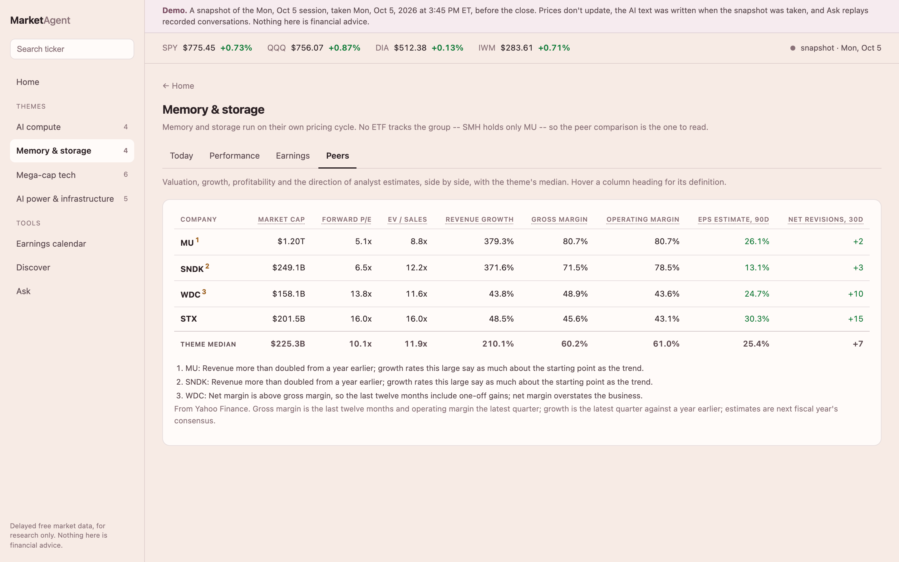
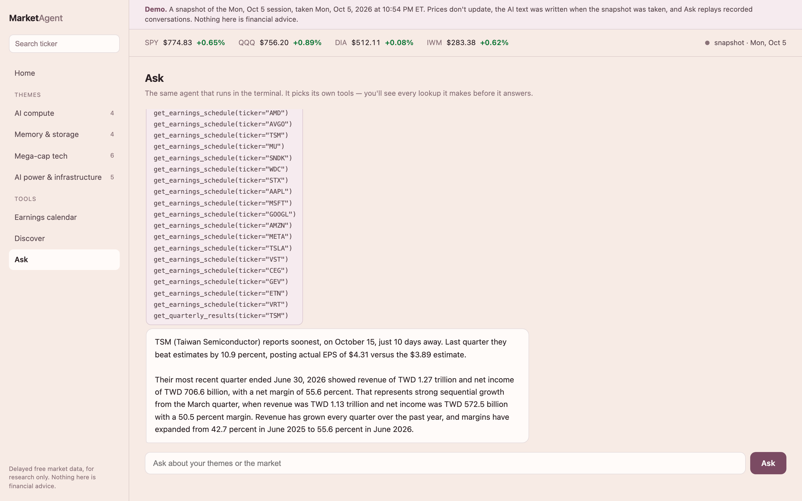
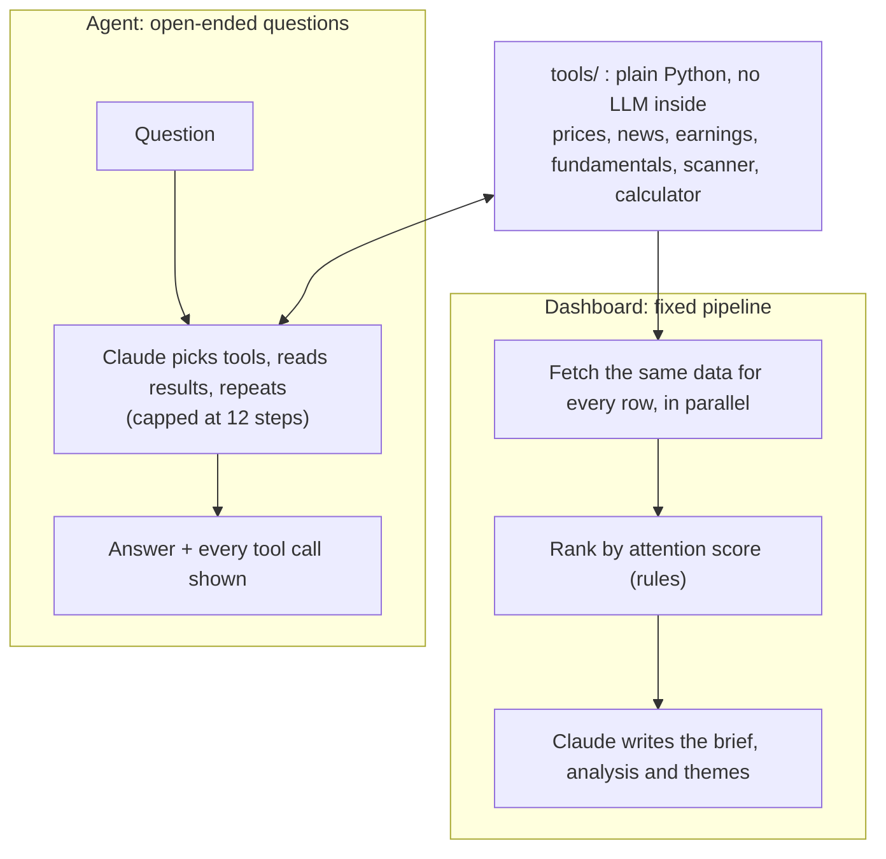

# Market Agent

A stock watchlist that ranks names by what needs attention today, plus a
tool-using Claude agent that answers questions from live market data
instead of from memory.

Ranking is done by plain Python rules; Claude is used only to explain. The
AI-written parts are covered by an eval suite that checks the model doesn't
give investment advice, assert causes the data doesn't support, or invent
facts that weren't in its input.



<!-- TODO: link to the hosted static demo once it's published -->

> Not financial advice. Data comes from free, delayed Yahoo Finance endpoints
> and can be incomplete or wrong. The prompts forbid buy/sell/hold opinions
> and price targets.

## What it does

**Dashboard** (`web/app.py`, a local web app)

The watchlist is organised into **themes**: groups of companies that share
a driver, each with a benchmark ETF. It ships with four (AI compute, Memory
& storage, Mega-cap tech, AI power & infrastructure), and themes and their
companies can be created, edited and moved from the page.

Every company is measured two ways: against its theme's ETF, and against
its **peers** — the median move of the other companies in the same theme,
the typical peer. The second matters because cap-weighted ETFs are
dominated by the names being measured (NVDA is over a fifth of SMH), and
the median because in a group of four one extreme name would decide an
average. Each move is then
labelled *with theme*, *partly shared* or *own move*, depending on how far
it diverged from its peers.

- **Home** — one card per theme: the theme's equal-weighted move against
  its ETF, how many companies beat it (breadth), how far apart they moved
  (dispersion), earnings this week, and the companies that most need
  attention. An AI brief on top tells each theme's story once and names the
  companies that diverged.
- **Theme page**, in four tabs:
  - *Today* — every company against the ETF and its peers, ranked by an
    attention score (size of move, divergence from peers, earnings
    proximity, news), with notes and the controls to edit the theme.
  - *Performance* — returns over 1M, 3M, 6M, YTD and 1Y, each against the
    ETF and the peers over the same window.
  - *Earnings* — each company's recent reports measured with an
    event-study market model: the abnormal reaction (the move beyond what
    beta and SPY predicted), how unusual it was in standard deviations of
    the stock's ordinary days, and the run-up before the report. Across the
    theme: how often beats were rewarded, and the rank correlation between
    surprise size and reaction, shown with its sample size.
  - *Peers* — forward P/E, EV/sales, growth, margins and the direction of
    analyst estimates, with the theme median and flags where a figure would
    mislead (one-off gains, near-zero earnings, base effects).
- **Stock page**, in three tabs: *Overview* (place in its theme today,
  six-month chart, AI analysis, headlines), *Earnings* (next report, and
  the abnormal reaction to each of the last eight), *Fundamentals & peers*
  (metrics with definitions, quarterly revenue, the theme's peer table).
- **Earnings calendar** — the next two weeks by theme, then three months.
- **Discover** — a market-wide scan of top gainers, losers and unusually
  active names (above $2B market cap and $5 a share), grouped into themes,
  each addable to one of yours.
- **Ask** — a chat panel backed by the same agent as the terminal, showing
  every tool call it made before answering.

<table>
<tr>
<td width="50%"></td>
<td width="50%"></td>
</tr>
<tr>
<td></td>
<td></td>
</tr>
</table>

**Agent** (`agent.py`, terminal or the Ask panel)

Twelve tools covering prices, history, news, earnings schedules and setups,
quarterly results, key stats, the market scanner, market news, upcoming
events, the watchlist, and a calculator. The agent chains them as needed,
e.g. *"which of my watchlist names reports soonest, and how did it do last
quarter?"*

## How it works



## Key decisions

- **Rank with rules, explain with the model.** The dashboard knows in
  advance what every row needs, so it calls the tools directly and ranks in
  Python; LLMs make slow, costly and inconsistent sorting functions, and
  good explainers. The agent handles questions nobody can anticipate, so
  there the model chooses the tools.
  [More](docs/DESIGN.md#the-two-agent-patterns-side-by-side)
- **Measure a move against its peers, not just an ETF.** Cap-weighted ETFs
  are dominated by the companies being compared with them, so each company
  is also measured against the median of the *other* companies in its
  theme. The rule for calling a move the theme's or the company's own was
  rewritten twice after the first live run broke it, and the average became
  a median after an eval fixture showed one jumping peer making three flat
  ones look like they'd diverged.
  [More](docs/DESIGN.md#themes-measuring-a-move-against-its-peers)
- **Evidence, not predictions.** Asked whether a stock will rise after
  earnings, the agent says direction isn't knowable and shows what already
  happened instead. Getting that evidence right meant reading each report's
  timestamp: a before-open report is traded the same day, an after-close
  one the next, and the first version measured the wrong session for every
  before-open reporter. [More](docs/DESIGN.md#will-it-go-up-after-earnings)
- **Test the AI part, and test the tests.** Regex checks what is fixed; an
  LLM judge grades what needs judgement and fails closed; repeated runs
  turn single results into pass rates; and the checks are fed bad output to
  prove they can fail.
  [More](docs/DESIGN.md#evals--testing-the-part-that-isnt-deterministic)

The full reasoning, and the mistakes that shaped it, are in
[docs/DESIGN.md](docs/DESIGN.md).

## Quick start

Requires Python 3.9+ and an [Anthropic API key](https://console.anthropic.com).

```bash
git clone <repo-url> market-agent
cd market-agent
python3 -m venv .venv
source .venv/bin/activate
pip install -r requirements.txt
cp .env.example .env          # then put your key in .env
```

Run the dashboard, then open <http://127.0.0.1:5050>:

```bash
python3 web/app.py
```

On macOS you can instead double-click `start.command`, which activates the
virtualenv, starts the server and opens the browser.

Or ask the agent from the terminal:

```bash
python3 agent.py                                  # interactive
python3 agent.py AAPL TSLA                        # quick update on each ticker
python3 agent.py "what moved most in the market today?"
```

### Configuration

| Variable | Required | Purpose |
|---|---|---|
| `ANTHROPIC_API_KEY` | yes | Claude API access |
| `MARKET_AGENT_MODEL` | no | Model for every Claude call, including the eval judge. Defaults to `claude-sonnet-4-5`. |

Set them in `.env` or the environment. Themes are saved to
`web/themes.json`, which is per-machine state and not committed; on first
run it's created from the default themes, and anything in an older
`web/watchlist.json` that they don't cover is kept in an "Other" theme.

## Static demo

Running the app publicly would mean paying for every visitor's AI calls and
being rate-limited by Yahoo from a cloud host. So the public version is a
**static snapshot**: `demo/build.py` walks the live app once -- real data,
real model -- and saves every page's data as JSON beside a copy of the
frontend, which reads those files instead of a server.

```bash
python3 demo/build.py                       # writes demo/site/
python3 demo/build.py --repo-url <url>      # adds a link to the banner
python3 -m http.server -d demo/site 8000    # look at it locally
python3 demo/capture.py --video             # retake the screenshots and walkthrough
```

Take it after the close: during trading hours the prices are intraday, and
the banner says so. `demo/capture.py` (needs Playwright, which isn't a
project dependency) regenerates the screenshots in this README from the
snapshot, and a walkthrough video into `demo/media/`.

The demo is read-only, says which session it's a snapshot of, and replays
the Ask panel's suggested questions as recorded (answers and lookups). Any
static host can serve `demo/site/` -- GitHub Pages, Netlify, Vercel, or a
subfolder of another site. It's gitignored until you decide to publish it.

Before publishing, note that the snapshot contains market data from Yahoo
Finance via yfinance, whose use is governed by Yahoo's terms.

## Tests and evals

**Offline tests** — free, instant, no network, no API key. CI runs these on
every push.

```bash
python3 run_tests.py
```

They stub the model and the market data, so they cover the deterministic
parts: ranking, routes, chat input handling, the agent loop (chaining,
errors as data, runaway protection), the calculator's refusals, and the eval
checks themselves, which are fed deliberately bad output to prove they can
fail.

**Evals** — call the real model and cost money. Run them after changing a
prompt or the model.

```bash
python3 evals/run_evals.py              # brief: 9 scenarios; stock analysis: 6; themes
python3 evals/run_agent_evals.py        # agent tool choices: 4 scenarios
python3 evals/run_evals.py --runs 3     # repeat for pass rates, not anecdotes
python3 evals/run_evals.py --dry-run    # exercise the harness, no API calls
python3 evals/run_evals.py --runs 5 --save   # also write the result to evals/results/
```

`--save` (on either runner) records each check's pass count, the first
output (with the agent's tool calls), the model, and the commit, so a
pass rate can be cited later.

Cheap checks (regex: required tickers, forbidden advice phrasing, format)
run first; an LLM judge grades what needs judgement against a written
rubric and fails closed. Agent evals use the real model on stubbed data, so
they can assert on the tool-call trace as well as the answer.
`--judge-stability N` separates a noisy judge from a noisy brief; see
[When to stop tuning](docs/DESIGN.md#when-to-stop-tuning).

`python3 test_tools.py AAPL` is a separate live smoke test of the data
tools (network, no API key), and `python3 tools/check_sources.py` reports
which data sources are reachable from your network.

## Project layout

```
agent.py              the agent: tool schemas, the loop, the CLI
config.py             shared settings (model, .env loading)
themes.py             theme storage: defaults, validation, upgrade from the old watchlist
tools/
  market_data.py      price, price history, company news, upcoming events
  market_scan.py      market-wide movers and market news
  fundamentals.py     earnings schedule and setup, quarterly results, key stats
  relative.py         peer medians, theme-vs-company attribution, breadth, dispersion
  performance.py      period returns, the event-study market model, rank correlation
  calc.py             safe arithmetic for the agent (parsed, never eval'd)
  check_sources.py    which data sources work from this network
  probe_*.py          scripts that inspect raw API payloads
web/
  app.py              Flask server: ranking, brief, detail, Discover, earnings, chat
  static/             single-page frontend, vanilla JS, no build step
evals/                model evals, scenarios, and tests of the checks
evals/tuning/         logs of the prompt tuning runs
demo/build.py         builds the static demo snapshot
demo/capture.py       screenshots and a walkthrough video of the snapshot
validation/           backtests of the hand-set rules, with their reports
run_tests.py          runs every offline suite
docs/DESIGN.md        design decisions and lessons
```

## Known limits

- Free delayed data via yfinance; no intraday streaming, options flow, or
  dark pool data.
- When a ticker's own Yahoo news feed is empty (as it was for every
  ticker in October 2026), headlines come from Yahoo's search
  endpoint instead. Those have no summaries, so the AI text works from
  headlines alone.
- Yahoo's operating margin is the latest quarter while its gross and net
  margins are twelve months; the pages label it, and flag it when the
  mismatch puts operating margin above gross margin.
- Market open/closed doesn't account for holidays.
- Notes and alerts are not built yet. Real alerts (fire while you're not
  looking) need a background scheduler, not just a web server.
- Discover depends on Yahoo's screener endpoint; if it's unavailable the
  page falls back to a fixed large-cap list and labels itself as such.
- The attention score's weights are hand-set. A two-year backtest
  ([validation/attention-2026-10.md](validation/attention-2026-10.md))
  found it agrees with the market's own attention (abnormal volume, IC
  +0.29), but favours volatile stocks, gives earnings points before a
  report rather than on the reaction, and says nothing about the next
  session. The changes it suggests haven't been made yet. The attribution
  thresholds (40% / 60% of the larger move, 1-point floor) haven't been
  validated.
- A theme that splits in two (hard-disk makers down 10%, memory makers down
  2%) labels every company as diverging, which is true but hides that each
  half moved together; there are no sub-groups within a theme yet.
- Theme averages (as opposed to peer comparisons) are equal-weighted means,
  so one extreme name still moves them -- SNDK's 2026 run dominates its
  theme's YTD average.
- Market-model betas estimated during a strong sector rally run high, which
  enlarges both expected and abnormal returns; the earliest report in each
  two-year history lacks enough prior data for a model and shows raw.
- Earnings timestamps come from Yahoo; a report time recorded wrongly
  (some carry a placeholder hour) puts the reaction on the wrong session.

## License

[MIT](LICENSE)
